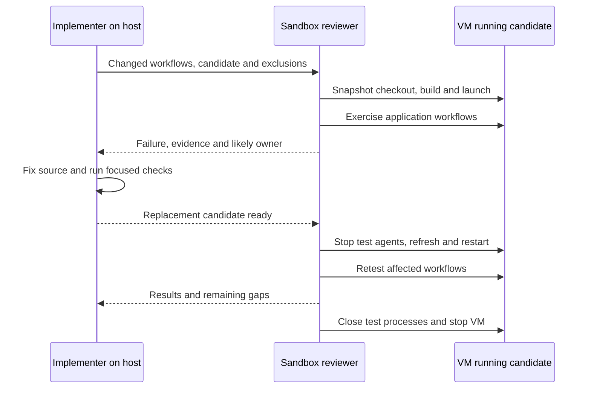

# How we test Pi changes in a sandbox

Our E2E reviews pair an implementing agent with a dedicated sandbox reviewer. The implementer works in the host checkout. The reviewer controls a disposable VM and uses the changed application: Pi, its extensions, Herdr agents and, where relevant, the Deno Notebook kernel.

The review is driven by the branch diff. We do not have a fixed E2E suite that every change runs through. The reviewer builds scenarios and small probes around the changed workflows, then works with the implementer to reproduce failures and retest fixes.



## From a diff to a review

We first read the net branch changes and group them by behaviour. A context-management change becomes a note-write, rollover and recovery scenario. A scheduling change becomes several real tool calls in one response. A shared-agent change becomes a child receiving its first task, reading shared context and reporting back to an idle or busy parent.

The assignment names the candidate, affected extensions, workflows, provider routes and exclusions. It also tells the reviewer which earlier evidence is reusable. That matters on a long-lived branch: an intermediate approach may already have been replaced, and repeating every previous check adds little.

The reviewer reports concrete failures as they appear. The implementer fixes host source while the reviewer continues independent scenarios. We use a shared board for findings and retest results, and notes for each agent's resumable state. The reviewer's completion report arrives asynchronously.

## What runs in the VM

We reuse a provisioned Pi Sandbox instance and replace its candidate checkout:

```sh
bun run sandbox:setup --name review
```

The [repository setup command](../../scripts/setup-repo-sandbox.mjs) transfers tracked working files, verifies the archive, installs the frozen lockfile and builds the required artifacts. New files must be staged to enter the snapshot. `sandbox-snapshot.json` records the source revision and archive hash.

The command prints the guest launch command. It uses an isolated Pi agent directory and the candidate's PCC and Shepherdr packages. The reviewer adds other affected extensions, such as Notes or GitHub Watch, to that guest configuration. It then checks the running application, rather than assuming a successful build means the intended extensions loaded.

The guest is not a live mirror. After a host fix, the reviewer stops its test agents, runs setup again and starts fresh processes against the replacement candidate. The VM's separate agent directory and test evidence survive candidate replacement.

Image provisioning and prerequisites belong in [Pi Sandbox's repository-review guide](../../packages/pi-sandbox/README.md#review-this-repository). We do not bundle an image. Our reviews have needed a guest-built native helper when the bundled binary required a newer libc. That used the supported `tools.customRustBinariesDir` setting, not an installed-package patch.

## How we drive the application

Interactive Pi and Herdr cover pane behaviour, commands, child agents and visible streaming. For narrower backend-acceptance checks, we also create a headless Pi session with the SDK, load the real extensions and call `bindExtensions` before sending the task. This still exercises application lifecycle and tools. It does not establish terminal UX.

Scenarios combine actions rather than just checking startup. For example: save a unique fact in a note, start a new context, read the fact back, search earlier history and continue with another tool. We have also left real idle and polling intervals running when timing itself was the behaviour under review.

Controlled HTTP, WebSocket and GitHub boundaries let the reviewer trigger retries, disconnects and notifications without waiting for an external service to misbehave. Live model runs answer a different question: whether the actual backend accepts the request and the model consumes the tool result. [Models and evidence](models-and-evidence.md) explains that split and how we switch between Codex Responses, Responses Lite and other providers' Chat Completions routes.

## Reusing the setup

- [Sandbox reviewer profile](assets/sandbox-reviewer/) contains the reusable review instructions. The profile's model runs the reviewer, not the application under test.
- [Headless launch example](headless.md) shows the SDK path used for focused acceptance checks.
- [Free-model verification skill](../../.pi/skills/pi-stuff-free-model-smoke/SKILL.md) covers live catalogue checks and a small tool-result round trip before selecting a free test model.

The reviewer finishes with what passed, what failed, what was blocked and where the evidence lives. We keep a host-accessible summary as well as guest captures. Temporary test credentials and owned processes are removed, then the VM is stopped. The implementer runs the remaining source checks after fixes converge. A sandbox pass does not update the host's installed extensions or publish a release.
